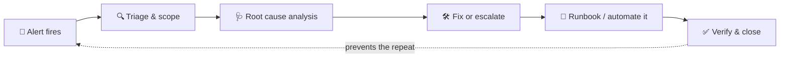
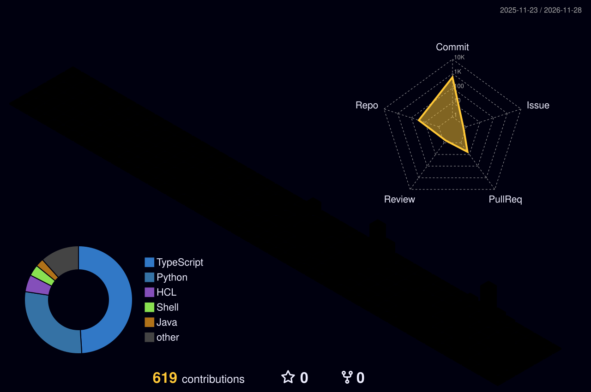

<!-- ===== HEADER: Wave Banner + Typing Animation ===== -->
<div align="center">


[](https://git.io/typing-svg)

**_"Hope is not a strategy."_** — SRE folklore, and how I actually work

</div>

---

<div align="center">

**🎯 Site Reliability Engineering · 🤖 AI / AIOps · 🐳 Kubernetes · 📊 Observability · ⚙️ Automation**

[](https://github.com/dineshravichandiran)
[](https://linkedin.com/in/dineshravichandiran)
[](mailto:dineshravichandiran0808@gmail.com)
[](https://dineshravichandiran.vercel.app/)
[](https://www.credly.com/users/dineshravichandiran)
[](https://hashnode.com/@dinesh101)

</div>

---

### 👨‍💻 About Me

```python
class DineshRavichandiran:
    def __init__(self):
        self.role = "Cloud & Reliability Engineer (SRE-focused), 4 years in production"
        self.company = "A Fortune 500 enterprise SaaS/PLM company"
        self.location = "Pune, India"
        self.mission = "Making downtime obsolete, one root cause at a time"

    @property
    def now(self):
        return [
            "24x7 incident response & observability for 50+ Fortune 500 customers",
            "Extending production ops into IaC/CI-CD — Terraform, GitHub Actions, Bicep (applied and drilled on real AWS and Azure accounts)",
            "Building AIOps, Kubernetes self-healing, and chaos-tested automation",
            "CKA in progress, AWS SAA next",
        ]

    @property
    def skills(self):
        return {
            "cloud": ["AWS", "Azure", "Kubernetes", "Docker"],
            "observability": ["Zabbix", "Prometheus", "Grafana", "Sumo Logic", "CloudWatch"],
            "iac_automation": ["Terraform", "Bicep", "GitHub Actions", "Ansible", "SaltStack"],
            "scripting": ["Bash", "Python"],
        }

    @property
    def track_record(self):
        return "99.9% uptime · ~30% smaller alert queue · 15+ runbooks authored"
```

Production systems fail for a reason, not by chance — find the actual root cause and the failure stops recurring, permanently. That's the job: incident response, root-cause engineering, and turning repeat manual fixes into automation that doesn't need a human at 2 a.m. Call it the Sherlock Holmes school of ops — the alert is never the crime, just the first clue.

I ship working systems, not slide decks about them. Where something has been run for real, the repo has the evidence; where it has not, the entry says so.

### 🧭 Core SRE Competencies

| | |
|---|---|
| **Incident Response & On-Call** | 24x7 rotation, triage, escalation, blameless postmortems, SLI/SLO thinking |
| **Root Cause Analysis** | Trend analysis on recurring alerts, turning repeat incidents into permanent fixes |
| **AIOps & AI-Driven Ops** | Event correlation, anomaly detection, ML-driven root-cause suggestion |
| **Kubernetes & Containers** | AKS pod/node troubleshooting, kubectl, k9s, chaos engineering — CKA in progress |
| **Observability** | Zabbix, Prometheus, Grafana, Sumo Logic, CloudWatch — full alert-lifecycle ownership |
| **Infrastructure as Code** | Terraform, Bicep, GitHub Actions, Ansible — repeatable over manual |
| **Automation & Self-Healing** | Salt beacons/reactors, event-driven remediation, cutting toil out of the loop |
| **Multi-Cloud** | AWS & Azure, cost & performance optimization at Fortune 500 scale |

<div align="center">

| 🎯 Alert Queue Cut | ⏱️ Uptime | 🏢 Fortune 500 Customers | 📘 Runbooks Authored | 🗓️ Experience |
|:---:|:---:|:---:|:---:|:---:|
| **~30%** | **99.9%** | **50+** | **15+** | **4 Years** |

</div>

---

### 🎯 Core Capabilities

Six things I actually do, not six things I studied:

- **Incident Response** — Real pressure, real production, across AWS & Azure. No dress rehearsal.
- **Root Cause Analysis** — Logs are clues, not conclusions. Same method as a detective: gather the evidence, rule out the obvious suspect, find the one that actually did it.
- **Kubernetes Troubleshooting** — CrashLoopBackOff, OOMKilled, scale-downs — diagnosed and resolved with kubectl & k9s, not guessed at.
- **Linux & Middleware Administration** — Fleets, not laptops. Apache, Tomcat, directory services, hardened at scale.
- **Monitoring & Observability** — Own the alert lifecycle end-to-end. If it's not validated before go-live, it's not monitored.
- **Process & Automation** — A recurring incident is a bug in the *process*. Fix that, not just the symptom.

Same loop every time — a live production incident, or one of the automated reactors in the projects below:



---

### 🛠️ Tech Stack

**Cloud & Containers**
<p>


</p>

**Operating Systems & Scripting**
<p>


</p>

**Monitoring & Observability**
<p>


</p>

**Data & ML**
<p>


</p>

**IaC & Automation**
<p>


</p>

**ITSM**
<p>


</p>

**Web (portfolio & side projects)**
<p>


</p>

**Currently Learning**
<p>


</p>

---

### 📊 GitHub Activity

<div align="center">




</div>

---

### 🚀 Featured Projects

A repo that doesn't run isn't a project, it's a claim. Everything below is code you can read, and each entry says plainly how far it has been verified. Grouped the way SRE roles screen: cloud and IaC that was applied for real, then agentic and AIOps tooling, then reliability and automation labs.

#### ☁️ Cloud & Infrastructure as Code — applied to real accounts, drilled, destroyed (evidence in each repo)

- ♻️ **[Self-Healing Infrastructure on AWS](https://github.com/dineshravichandiran/cloud-devops-projects/tree/main/self-healing-aws-infra)** — Terraform VPC/ALB/Auto Scaling Group with CloudWatch alarms and Lambda auto-remediation for failures ASG health checks alone don't catch. Drilled with real failures (ASG replacement, Lambda restart, alarm → Lambda → ASG chain), then destroyed; running it found and fixed four defects.
- 🏗️ **[AWS SRE Platform in Terraform](https://github.com/dineshravichandiran/aws-sre-platform-terraform)** — VPC, ALB, ECS Fargate and RDS as modules, remote state, GitHub Actions authenticating through OIDC (no stored AWS keys), checkov in CI. Five failure drills (task kill, drift detection, state lock, bad release rolled back), then destroyed.
- 🌐 **[AWS Hub-and-Spoke Network in Terraform](https://github.com/dineshravichandiran/aws-hub-spoke-network-terraform)** — Transit Gateway hub with central NAT, isolated spokes, private DNS and Reachability Analyzer paths. The first real run found two bugs (ping blocked by a network ACL; spokes not isolated because traffic hairpinned through the hub NAT), both fixed and re-verified. A second run drilled a network-ACL deny and a flow-log REJECT record.
- ☸️ **[EKS + Argo CD GitOps Platform](https://github.com/dineshravichandiran/cloud-devops-projects/tree/main/eks-gitops-platform)** — Terraform for a private-node EKS cluster that Argo CD runs workloads on. Applied once, an Argo CD self-heal drill run, destroyed, account checked for leftovers.
- 🔐 **[Azure Secure Web App in Bicep](https://github.com/dineshravichandiran/cloud-devops-projects/tree/main/azure-secure-webapp-bicep)** — App Service reading a secret from Key Vault through a Key Vault reference with its own managed identity (no stored credentials), logs to Log Analytics and Application Insights. Applied once to Azure: removing the role made the app return 503 `AccessToKeyVaultDenied` after about 12 minutes, restoring it brought 200 back; destroyed with a clean leftover check. The write-up also records a bug in my own first drill script.
- 🔄 **[Azure DevOps Pipeline](https://github.com/dineshravichandiran/azure-iac-bicep/tree/main/azure-devops-pipeline)** — multi-stage pipeline (build, security checks, Bicep provisioning, dev → staging → production with approvals and slot swaps). **Run end to end on a real Azure DevOps organization on 2026-11-21, then destroyed:** three runs failed for real reasons and were fixed, the fourth went green. Production ran S1, not P1v3 (trial quota).

#### 🤖 Agentic SRE & AIOps

- 🧰 **[Ops MCP Server](https://github.com/dineshravichandiran/cloud-devops-projects/tree/main/ops-mcp-server)** — an MCP server that lets an AI agent read AWS and Kubernetes while on call; writes need a person to approve that exact change first, once. 33 tests in CI (stubbed AWS and kubectl); read-only AWS calls checked on a live account.
- 🛡️ **[Guardrailed SRE Incident-Response Agent](https://github.com/dineshravichandiran/agentic-sre-responder)** — rule-based planner, JSON-output LLM planner and a tool-calling LLM agent behind one guardrail layer (restart limits, healthy-metrics check, human hand-off). Seven-scenario evaluation; tests fail when each safety check is removed.
- 🔎 **[AI Incident Triage Agent](https://github.com/dineshravichandiran/ai-incident-triage-agent)** — filters alert logs, names the likely cause, retrieves the runbook step and drafts the note; any fix needs a human-issued approval enforced in code. On 20 frozen incidents, filtered context cut input tokens 91% at equal accuracy; hybrid BM25 + embedding retrieval ranked the right runbook first in 42 of 50 test queries against 39 for BM25 alone.
- 🤖 **[AIOps Alert Correlation & RCA Engine](https://github.com/dineshravichandiran/aiops-alert-correlation)** — sliding-window correlator (76.9% noise reduction, 13,833 raw alerts → 3,197 incidents on a synthetic set), an IsolationForest anomaly detector and a RandomForest root-cause classifier (56.8% accuracy vs. ~12.5% random baseline). 8 passing tests.

#### ⚙️ Reliability, Observability & Automation Labs

- ☸️ **[Kubernetes Self-Healing & Chaos Lab](https://github.com/dineshravichandiran/k8s-self-healing-lab)** — a controller that detects and auto-remediates CrashLoopBackOff and OOMKilled; chaos scripts trigger both. Verified live in a kind cluster in a GitHub Codespace: triggered, detected and remediated within seconds, fully logged.
- 🛠️ **[Runbook Automation Engine](https://github.com/dineshravichandiran/runbook-automation-engine)** — executable YAML runbooks (check, remediate, verify) with dry-run and a JSON audit log. Verified live against a real memory leak, a real full disk and a real crashed service. 5 passing tests.
- 🧠 **[Salt Self-Healing Memory Guard](https://github.com/dineshravichandiran/salt-self-healing-memory)** — a custom Salt beacon watches a service's memory and a reactor restarts it before an OOM kill. Three consecutive detect → restart → log cycles verified.
- 🔐 **[End-to-End DevSecOps CI Pipeline](https://github.com/dineshravichandiran/devsecops-ci-pipeline)** — GitHub Actions running secret scanning, SAST, SCA, container scanning and DAST on every push, findings in the Security tab. Found and fixed three real failures; all 8 jobs run green. Trivy and ZAP are report-only so far; the staging deploy and policy gate are still placeholders. [](https://github.com/dineshravichandiran/devsecops-ci-pipeline/actions/workflows/devsecops-pipeline.yml)
- 📊 **[Grafana + Prometheus Observability Stack](https://github.com/dineshravichandiran/grafana-observability-stack)** — dashboards and alert rules provisioned entirely as code over a synthetic exporter; verified running live in a GitHub Codespace.
- ⚙️ **[Ansible: Zabbix Onboarding + Host Baseline](https://github.com/dineshravichandiran/ansible-zabbix-baseline)** — takes a fresh host to monitored-and-hardened; found and fixed two real bugs against real systemd containers; a clean re-run verifies `changed=0`.
- 🌐 **[net-healthcheck](https://github.com/dineshravichandiran/net-healthcheck)** — OSI-layer diagnostics (DNS, TCP, HTTP(S), TLS expiry) with a Nagios-convention exit code. Caught 3 real bugs in testing; 14/14 tests passing.
- 🧰 **[ops-toolkits](https://github.com/dineshravichandiran/ops-toolkits)** — five change-window and config-drift tools (Bash + PowerShell), report-only by default. 200/200 tests passing.
- 📡 **[Zabbix Monitoring Lab](https://github.com/dineshravichandiran/zabbix-monitoring-lab)** — LLD discovery filters (real before/after item count) and a severity-escalation action where I caught and fixed a real timing bug.
- 📈 **[Cloud Incident & Reliability Analytics](https://github.com/dineshravichandiran/cloud-incident-analytics)** — a synthetic, seeded incident dataset plus a Tableau dashboard brief: SLI/SLO tracking, MTTR trend, error-budget burn, root-cause Pareto, forecasting.

📌 Also on GitHub: this [portfolio site](https://github.com/dineshravichandiran/Portfolio) (React/TypeScript/Three.js), a Linux ops cheatsheet, and a tech events journal — full list at [github.com/dineshravichandiran](https://github.com/dineshravichandiran?tab=repositories).

---

### 🏆 Achievements

Proof, not adjectives:

- 🥇 **Winner — Smart India Hackathon 2020** (National Level, 10,000+ competing teams) — built a chatbot-abuse detection tool for India's Bureau of Police Research & Development
- ⭐ **Recognized by leadership three times in the last two years** — for resolving a large monitoring/compliance backlog, for cross-team performance and cost-optimization work, and for stabilizing customer environments during the 2024 CrowdStrike global outage and a DigiCert certificate expiry
- 📜 **Microsoft Certified** — AZ-900, DP-900 · Certified Kubernetes Administrator (CKA) in progress
- ☸️ **KubeCon + CloudNativeCon India** — Attended 2025 & 2026

---

### 🤝 Open Source & Writing

- ✍️ **Technical writing** — 16+ posts on [Medium](https://medium.com/@dineshravichandiran) since 2023, most recently:
  - *From Flat Networks to NightsWatch* — notes from SRE Day Chennai 2025 (Kubernetes NetworkPolicies with Calico/Cilium, Coroot + ClickHouse at scale, a battle-tested on-call flow)
  - *The Twelve-Factor App* — from Heroku's original vision to today's cloud-native standard
  - *SRE, JVM & Observability Keywords Explained*
  - *K8s vs. K9s — What's the Difference?*
- 📔 **[Thread & Heap Dumps: SRE Deep Dive](https://jvm-thread-heap-dumps-sre.hashnode.dev)** — a dedicated blog on JVM/production debugging: thread dumps, heap dumps, memory leaks, and the incidents behind them.
- 🌱 **External open-source contributions** — haven't sent a PR to someone else's project yet; it's next on the list once the current self-directed projects above are in good shape.

---

### 💡 Beyond Operations

Ops isn't the ceiling. I build interactive web experiences from scratch — **HTML, CSS, JavaScript**, custom animations, responsive design — and use AI tools (ChatGPT, Gemini, Copilot) as leverage to learn and ship faster, not as a crutch.

---

### 🤝 Let's Talk

<div align="center">

**Cloud, reliability and AIOps — production-tested, not just certified.**

I also run 1:1 sessions on job interview tips and career guidance — ★ 5/5 on Topmate.

[](https://topmate.io/dinesh_ravichandiran/)

</div>

---

<div align="center">

***"Preparation beats panic, every time."*** — Learned from 4 years of on-call rotations 🚀

</div>

---

### 💬 Quote

<!-- QUOTE:START -->
> *“SRE is what happens when you ask a software engineer to design an operations team.”*
>
> — Ben Treynor Sloss
<!-- QUOTE:END -->

---

<p align="center"><sub>© 2026 Dinesh Ravichandiran — personal branding material, not open-source. See <a href="LICENSE">LICENSE</a>. Like the format? Please fork rather than copy.</sub></p>


